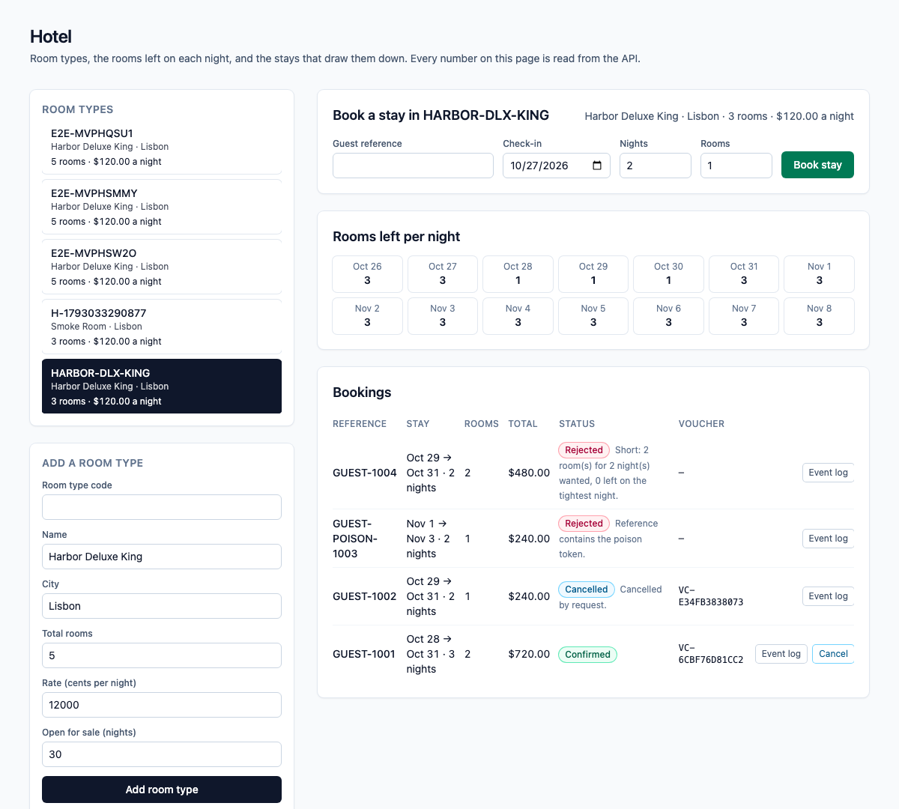
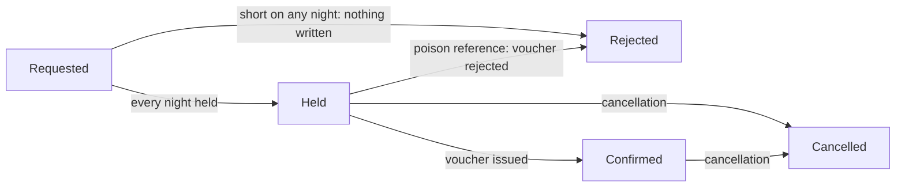
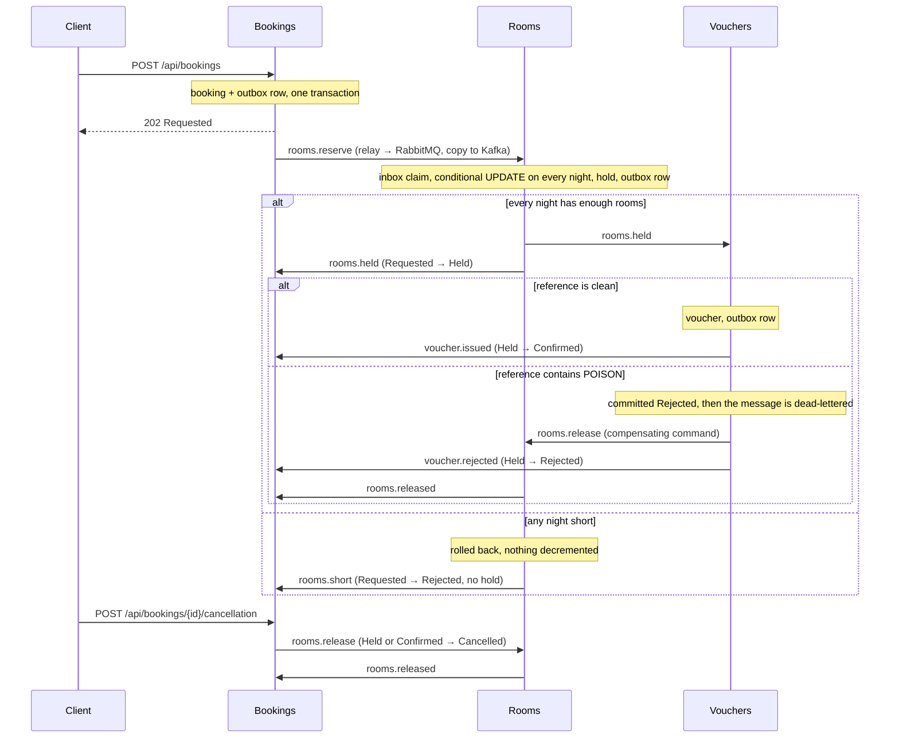

# dotnet-hotel

Room types, the rooms left on each night, and the stays that draw them down. The scarce number is **rooms left on a given night of a room type**, and the **Rooms** module is its only writer. A stay is all-or-nothing: one conditional `UPDATE` decrements every night of the stay that still has enough rooms, and the hold is kept only if it touched every night. When two guests fight for the last room, one commits a hold and the other is short, with no hold written and no night touched. A guest reference that contains the poison token `POISON` is committed as rejected by the Vouchers module, the message is dead-lettered, and a compensating command gives every night back. A later cancellation also gives every night back, but it does not roll back the voucher that was already issued.

One ASP.NET Core process, one Postgres database. An HTTP write saves the booking and an outbox row in one local transaction; a `BackgroundService` relay publishes outbox rows to RabbitMQ (the work queue) and Kafka (the event log); the next module consumes from RabbitMQ, claims an inbox key in the same transaction as its own write, and writes its own row and outbox row. Saga steps never call each other in-process. Delivery is at-least-once: the relay can publish and crash before it marks a row sent, so the row goes out again, and every consumer dedupes with its inbox key. Each saga step only moves a booking forward from the status it expects.

> The Compose network is local and unauthenticated. There is no login, no token and no cookie. Do not publish these ports; Compose binds all of them to `127.0.0.1`.



*The UI reads everything from the API. Shown: a room type with three rooms, a three-night stay holding two of them, a cancelled stay that gave its nights back and kept its voucher, a poison rejection, and a stay that was short on its tightest night.*

## Why per-night rows

Hotel availability is not one number. A stay over three nights needs a room on each of those nights, and two stays can overlap on only one of them. So availability is one row per room type per night (`RoomNights`), and a stay updates a run of rows. The hold query matches only the nights that still have enough rooms; if it touches fewer rows than the stay has nights, the whole transaction is rolled back, which undoes the nights that did match, and the booking is told it is short. The overlapping-stays test runs that race five times and asserts that the loser leaves every night exactly as it found it.

## Money

Prices are whole cents. A stay costs the nightly rate × nights × rooms, so three nights of two rooms at $120.00 is $720.00. A booking is 1 to 14 nights and 1 to 3 rooms, and check-in cannot be in the past. The arithmetic is `checked`: it throws instead of wrapping.

## Booking statuses



`Cancelled` and `Rejected` (after a hold) give every night back through a `ReleaseRooms` command, and Rooms releases a hold at most once. The voucher has its own status (`Issued` or `Rejected`) and a cancellation never changes it. If the cancellation gets there before the final mark, the late mark finds the booking is no longer `Held` and does nothing.

## How the modules talk



| Module | Owns | Consumes | Emits |
| --- | --- | --- | --- |
| **Bookings** (`Modules/Bookings`) | `Bookings`: status, stay dates, rooms, total, guest reference. Validation, the poison rule, the price. | `rooms.held`, `rooms.short`, `voucher.issued`, `voucher.rejected`, `rooms.released` | `rooms.reserve`, `rooms.release` (cancellation) |
| **Rooms** (`Modules/Rooms`) | `RoomTypes`, `RoomNights.RoomsLeft` (sole writer after a room type opens) and `RoomHolds`. | `rooms.reserve`, `rooms.release` (prefetch 1) | `rooms.held`, `rooms.short`, `rooms.released` |
| **Vouchers** (`Modules/Vouchers`) | `Vouchers`. | `rooms.held` | `voucher.issued`, `voucher.rejected`, `rooms.release` (poison) |
| **Messaging** (`Messaging`) | `OutboxMessages`, `InboxMessages`, the relay, the consumer loop with retry and dead-letter, the Kafka log. | | |

RabbitMQ topology is declared in code (`Messaging/Topology.cs`): exchange `hotel.work`, one queue per module (`rooms.commands`, `vouchers.work`, `bookings.events`), a `.retry` queue per module (2 s TTL, then back to the main queue, 3 attempts), and a `.dlq` per module behind `hotel.dlx`. A transient failure retries; a poison message goes straight to the dead-letter queue after its rejection is committed. Kafka has one topic, `hotel.events`, one partition, replication factor 1, keyed by booking id.

## Run it

Needs Node 22 (npm 10), .NET SDK 10.0.401 (`global.json`), Docker (arm64 is fine) and python3 for the smoke script.

```bash
npm ci
docker compose up -d --wait db        # dotnet test uses Postgres on 5476 (database hotel_test)
dotnet test tests/api/Hotel.Api.Tests.csproj
docker compose up --build --wait      # db, kafka, rabbitmq, api, web
./scripts/smoke.sh                    # last line: hotel smoke passed
npx playwright install chromium       # once
npx playwright test                   # two specs against http://127.0.0.1:8096
docker compose down                   # keeps the Postgres volume; `down -v` drops it
```

| Service | Host port |
| --- | --- |
| Web (nginx, proxies `/api/`) | 8096 |
| API (`/scalar/v1`, `/api/health`) | 5216 |
| Postgres 17 | 5476 |
| Kafka 3.8.1 (KRaft, one broker) | 9126 |
| RabbitMQ 3.13 / management UI (`platform` / `platform`) | 5706 / 15706 |

Inside the Compose network the API and nginx listen on 8080 and Kafka's internal listener is 9092.

## Try it with curl

```bash
curl -s -X POST http://127.0.0.1:5216/api/room-types \
  -H 'content-type: application/json' \
  -d '{"code":"HARBOR-DLX-KING","name":"Harbor Deluxe King","city":"Lisbon","totalRooms":3,"rateCents":12000,"openNights":30}'

CHECKIN=$(python3 -c "import datetime; print(datetime.date.today() + datetime.timedelta(days=2))")
curl -s -X POST http://127.0.0.1:5216/api/bookings \
  -H 'content-type: application/json' \
  -d "{\"roomTypeCode\":\"HARBOR-DLX-KING\",\"reference\":\"GUEST-1001\",\"checkIn\":\"$CHECKIN\",\"nights\":3,\"rooms\":2}"
# The room type is open from today for 30 nights, so the check-in has to fall inside that window.
# 202, status Requested, totalCents 72000. Use the returned id:

curl -s http://127.0.0.1:5216/api/bookings/<id>                   # Confirmed after a few seconds, with a voucher number
curl -s http://127.0.0.1:5216/api/vouchers/<id>
curl -s "http://127.0.0.1:5216/api/room-types/HARBOR-DLX-KING/availability?from=$CHECKIN&days=7"   # rooms left per night
curl -s http://127.0.0.1:5216/api/bookings/<id>/events            # the Kafka log for this booking

curl -s -X POST http://127.0.0.1:5216/api/bookings/<id>/cancellation \
  -H 'content-type: application/json'                             # every night comes back; the voucher stays
```

A booking is validated at the door: guest reference required (at most 40 characters), a check-in that is not in the past, 1 to 14 nights, 1 to 3 rooms, and every night of the stay must be open for sale. The poison match is a case-sensitive substring: `GUEST-POISON-7` and any longer token containing `POISON` match.

## Develop with Nx

The repository is an Nx workspace (`nx.json`, plugin `@nx/dotnet`). `npx nx show projects` lists `api` (the ASP.NET Core monolith), `web` (the Angular app) and the inferred xUnit project.

```bash
docker compose up -d --wait db kafka rabbitmq   # the brokers and Postgres, not the app
npx nx serve api                                # http://localhost:5216
npx nx serve web                                # http://localhost:4296, proxies /api to the API
WEB_URL=http://localhost:4296 npx playwright test   # the same browser specs, against the dev servers
npx nx run-many -t typecheck lint -p web        # tsc --noEmit and ESLint (angular-eslint)
npx nx build web && npx nx build api            # what CI builds
```

## What is tested, and where it runs

- **xUnit against real Postgres** (`tests/api`, 27 tests): two concurrent stays for the last room (one `Held`, one `Short`, every night 0 for the winner's dates, no hold for the loser); two stays that overlap on one night, five rounds, where the loser must leave every night untouched; a stay that runs past the last open night is short and decrements nothing; a release gives every night back exactly once; the same message delivered twice is claimed once; empty, past and over-limit input, integer overflow (4294967297 must not wrap to 1), the price and its checked arithmetic, the poison substring; the poison rejection is committed before the dead-letter; a cancellation followed by the late final mark leaves the booking `Cancelled` and the voucher `Issued`. Two mutations were run against the hold and both are caught: accepting a partial stay fails the overlap and past-the-end tests, and a read-then-write version fails the race and overlap tests.
- **`scripts/smoke.sh`** drives the composed stack with a run id on every code, so a kept volume does not collide: validation, the happy path (price, voucher, per-night counts, Kafka log), three concurrent identical stays for one room (one confirmed, two short), a stay overlapping the sold-out night that is short and leaves the other nights at 1, the poison reference (rejected, `vouchers.work.dlq` gains one message, every night restored), and a cancellation that lands between the voucher and the final mark (booking `Cancelled`, voucher `Issued`, nights back, second cancellation `409`). To make that last window wide enough to hit on purpose, Compose sets `Bookings__FinalMarkDelayMs=1500`; it is a latency knob and defaults to 0.
- **Playwright** (`e2e/specs/book-stay.spec.ts`): adds a room type in the UI, books a stay, sees `Confirmed`, the voucher number and the three nights drop while the next night does not, reloads to prove the page reads the API and keeps nothing in `localStorage`, then cancels and sees the nights come back. A second spec, `e2e/specs/ui-flows.spec.ts`, drives the page through the refusal messages (too many nights or rooms, a past date, an empty reference, a duplicate), the poison rejection, the last room going to one stay while an overlapping stay changes nothing, and the Kafka event log panel. Both specs pass against the Compose stack and against the Nx dev servers.
- **CI** (`.github/workflows/ci.yml`, on push) has two jobs. `verify`: `npm ci`, Prettier check, `dotnet format whitespace --verify-no-changes`, `dotnet test` with a Postgres 17 service, `nx typecheck` and `nx lint` for web (ESLint with angular-eslint, template accessibility rules included, zero warnings allowed), and `nx build` for web and api. `e2e`: builds the Compose stack on the runner, runs `scripts/smoke.sh` and both Playwright specs against it, uploads the Playwright traces and prints the Compose logs on failure.

## API

All routes are unauthenticated JSON. Interactive docs are at `http://127.0.0.1:5216/scalar/v1` (OpenAPI at `/openapi/v1.json`); the web port proxies `/api/`, `/scalar/` and `/openapi/` too.

| Method and path | What it does | Responses |
| --- | --- | --- |
| `GET /api/health` | Liveness. | `200 Healthy` |
| `POST /api/room-types` | Opens a room type for sale on a run of nights (default 30 from today). | `201`, `400` invalid, `409` code exists |
| `GET /api/room-types` | Lists room types. | `200` |
| `GET /api/room-types/{code}` | One room type. | `200`, `404` |
| `GET /api/room-types/{code}/availability?from=&days=` | Rooms left on each night (default from the first open night, 14 days, at most 60). | `200`, `404` |
| `POST /api/bookings` | Accepts a stay and starts the saga. | `202` Requested, `400` invalid, `404` unknown room type, `409` duplicate reference |
| `GET /api/bookings?roomTypeCode=` | Lists the latest 100 bookings, optionally for one room type. | `200` |
| `GET /api/bookings/{id}` | One booking and its status. | `200`, `404` |
| `POST /api/bookings/{id}/cancellation` | Moves a held or confirmed booking to `Cancelled` and gives every night back. The voucher is not touched. | `202`, `404`, `409` wrong status |
| `GET /api/bookings/{id}/events` | The Kafka event log for one booking, read from the start of the topic. | `200` |
| `GET /api/vouchers/{bookingId}` | The voucher row. | `200`, `404` until the step has run |

Errors come back as `application/problem+json` with a `title`.

## Configuration

Compose sets these on the API container. Defaults in `apps/api/appsettings.json` point at the published host ports, so `nx serve api` works against `docker compose up -d --wait db kafka rabbitmq`.

| Setting | Compose value | Meaning |
| --- | --- | --- |
| `ConnectionStrings__Hotel` | `Host=db;Port=5432;Database=hotel;Username=hotel;Password=hotel` | The one Postgres database. Migrations run on startup. |
| `RabbitMq__Host` / `__Port` / `__User` / `__Password` | `rabbitmq` / `5672` / `platform` / `platform` | Work queue. Virtual host `/`. |
| `Kafka__BootstrapServers` | `kafka:9092` | Event log. |
| `Bookings__FinalMarkDelayMs` | `1500` | Milliseconds the final mark waits. A latency knob so the smoke can land a cancellation inside the window. `0` outside Compose. |
| `HOTEL_TEST_DB` (tests only) | | Postgres connection for `dotnet test`. Defaults to `localhost:5476`, database `hotel_test`. CI points it at its service container. |

## Look inside and fix things

```bash
docker compose ps                      # five services, all healthy
docker compose logs -f api             # relay, consumers, poison and retry lines
docker compose exec db psql -U hotel -d hotel -c 'select "Night","RoomsLeft" from "RoomNights" order by "Night" limit 10'
open http://127.0.0.1:15706            # RabbitMQ management, platform / platform
```

- **Dead-lettered messages** sit in `vouchers.work.dlq`. Nothing replays them; inspect them in the management UI. Retries wait in `<queue>.retry` for 2 seconds.
- **A port is already in use**: `lsof -nP -i :5216` shows who holds it. Compose publishes only on `127.0.0.1`.
- **`dotnet test` cannot connect**: start Postgres first with `docker compose up -d --wait db`.
- **The smoke cannot reach the API**: run `docker compose up --build --wait` first; override the target with `API=... RABBIT=... ./scripts/smoke.sh`.
- **Start clean**: `docker compose down -v` drops Postgres, Kafka and RabbitMQ data. Plain `down` keeps them, and the smoke is safe on kept data because every code carries a run id.
- **The Kafka log looks empty right after a booking**: the relay publishes within a second or so; reload the event log.
- **A booking is rejected with a 400 about open nights**: the room type is only open for the nights it was created with; the window starts at the room type's first night.

## Known limits

- It is unauthenticated on purpose. Anything that can reach the API can read and write everything.
- It sells one number per room type and night. There are no individual rooms, no rate plans, no payment, no overbooking allowance and no hold expiry: a held booking waits for its voucher, it does not time out.
- Delivery is at-least-once, not exactly-once. The inbox makes repeats harmless for the saga; the Kafka log can hold a duplicate event after a relay crash.
- Two stays updating overlapping nights lock rows in index order, which keeps deadlocks unlikely but not impossible; a deadlock surfaces as a transient failure and the message is retried.
- One broker, one partition, replication factor 1, one API instance. The relay does not coordinate across instances (the inbox would absorb the duplicates, but the outbox is never trimmed).
- `GET .../events` scans the whole topic for each call. Fine here, not something to expose at scale.
- Lists are capped at 100 rows and not paginated.
- Dead-lettered messages are not replayed automatically.
- The browser specs drive Chromium at a desktop size only, and the `e2e` CI job needs Docker and takes a few minutes.

## Cloud mapping

This repository runs on Compose. Nothing in it calls a cloud account.

| Here | On AWS |
| --- | --- |
| Postgres 17 | RDS for PostgreSQL |
| Kafka 3.8 | MSK |
| RabbitMQ 3.13 | Amazon MQ, or SQS with a dead-letter queue |
| The API and the web app | ECS or App Service |

## Layout

```
apps/api      ASP.NET Core monolith: Modules/{Bookings,Rooms,Vouchers}, Messaging, Data, Migrations
apps/web      Angular 21, styled with Tailwind 4 utilities only
tests/api     xUnit against Postgres
e2e/          Playwright
scripts/      smoke.sh
compose.yaml  Postgres, Kafka, RabbitMQ, API, web
```

Nx 23.2.1 orchestrates `nx build web`, `nx lint web`, `nx typecheck web` and `nx build api`; EF Core migrations are committed and the API applies them on startup.

## Other systems in this .NET track

- [dotnet-freight](https://github.com/joshbarros/dotnet-freight): container space on ocean sailings.
- [dotnet-clinic](https://github.com/joshbarros/dotnet-clinic): appointment slots in a provider session.
- [dotnet-ledger](https://github.com/joshbarros/dotnet-ledger): outgoing payments from an account balance.
- [dotnet-warehouse](https://github.com/joshbarros/dotnet-warehouse): warehouse stock and outbound orders.
- [dotnet-academy](https://github.com/joshbarros/dotnet-academy): course cohort seats and enrollments.
- [dotnet-compute](https://github.com/joshbarros/dotnet-compute): GPU-hour reservations in a pool.
- [dotnet-tickets](https://github.com/joshbarros/dotnet-tickets): event ticket tiers and orders.
- [dotnet-carbon](https://github.com/joshbarros/dotnet-carbon): carbon credit batches and purchases.
- [dotnet-charging](https://github.com/joshbarros/dotnet-charging): EV charger slot reservations.
- [dotnet-promo](https://github.com/joshbarros/dotnet-promo): limited-use promo codes and redemptions.
